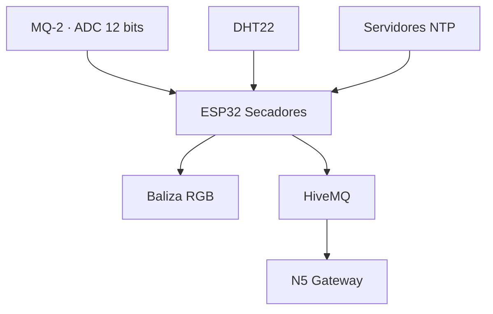

# N2 — Secadores

Nodo de monitoreo ambiental de la línea de secado de harina de Planta Costa Norte (G1).

**Responsable:** Eduardo Chacaliaza — Integrante 2.

## Simulación

- [Instalación original](https://wokwi.com/projects/481589874625672193)
- [Instalación corregida y validada](https://wokwi.com/projects/481603469063491585)
- [Registro experimental e integración](../evidencias/pruebas/N2-Secadores.md)

## Hardware

ESP32, MQ-2 (GPIO34), DHT22 (GPIO15) y baliza RGB de cátodo común (GPIO25, 26 y 27).

## Comunicación

Broker MQTT: `broker.hivemq.com:1883`. Tópico: `upc/ga/secadores/datos`. Publicación cada 2000 ms. El mensaje contiene concentración numérica en ppm, temperatura, humedad, timestamp NTP y HMAC-SHA256 truncado a 16 caracteres hexadecimales. La clave compartida se configura localmente mediante `secrets.h`, a partir de `secrets.example.h`.

## Auditoría

| ID | Tipo | Paso del marco IoT | Corrección | Trazabilidad |
|---|---|---|---|---|
| F5 | Visible | Paso 4: Definición de los requisitos de la capa de intercambio (R8) | Periodo de 100 a 2000 ms | [PR 6](https://github.com/educmz/laboratorio-4-planta-costa-norte-g1/pull/6) |
| F6 | Silenciosa | Paso 10: Definición del procesamiento de datos en cada nodo y en la nube (R1) | Interpolación de siete puntos experimentales ADC/ppm | [PR 7](https://github.com/educmz/laboratorio-4-planta-costa-norte-g1/pull/7) |
| F7 | Seguridad | Paso 4: Definición de los requisitos de la capa de intercambio (R9) | Firma HMAC de id, timestamp y valor | [PR 8](https://github.com/educmz/laboratorio-4-planta-costa-norte-g1/pull/8) |
| F8 | Cruzada | Paso 7: Selección de las arquitecturas de intercambio de datos e integración de información | Suscripción N5 a datos en plural | [Commit N5](https://github.com/educmz/laboratorio-4-planta-costa-norte-g1/commit/9ebf24c) |
| EXTRA-N2-01 | Adicional | Paso 7: Selección de las arquitecturas de intercambio de datos e integración de información | Client ID diferenciado por nodo y MAC | [PR 9](https://github.com/educmz/laboratorio-4-planta-costa-norte-g1/pull/9) |

## Observaciones previas del grupo

La versión consolidada de Wokwi publicó seis mensajes consecutivos con diferencias de 2 s en sus timestamps. Las pruebas de calibración produjeron 393.0, 1839.3 y 2500.0 ppm con balizas verde, amarilla y roja, respectivamente. El Gateway aceptó lecturas de Secadores de 400.0 y 2500.0 ppm y rechazó un mensaje con firma inválida. Los registros experimentales describen el alcance de la prueba.

La integración al código principal se gestiona mediante los PR individuales y la revisión independiente. El firmware original permanece disponible en el historial de Git.

## Arquitectura y conexiones

| Componente | Conexión ESP32 | Función |
|---|---|---|
| MQ-2 AOUT | GPIO34 | Entrada analógica de gas |
| DHT22 SDA | GPIO15 | Temperatura y humedad |
| Baliza R/G/B | GPIO25/26/27 | Salidas activas en alto con cátodo común a GND |
| MQ-2 y DHT22 | 3V3 y GND | Alimentación del modelo virtual |

## Configuración y ejecución

1. Abrir el [circuito](diagram.json) en una copia privada de Wokwi ESP32 y cargar [sketch.ino](sketch.ino) y [libraries.txt](libraries.txt).
2. Copiar [secrets.example.h](secrets.example.h) como `secrets.h` y configurar localmente la clave acordada. Git ignora este archivo. Utilizar cero segundos de ajuste como punto de partida.
3. Iniciar N5 y N2 juntos, abrir el monitor a 115200 baudios y comprobar el estado de NTP. Durante el ensayo variar la concentración y comprobar el registro de aceptación en el receptor.
4. Para reproducir la verificación local y usar el cliente manual, consultar el [protocolo de pruebas](docs/PRUEBAS.md).

El cliente del ESP32 usa el puerto 1883 y el navegador usa WSS en 8884. El JSON contiene id, ts, valor, unidad, temp, hum, equipo, zona, responsable, calidad y firma. El campo `valor` conserva un decimal en el JSON y en el texto autenticado. El nodo no emite una lectura sin hora válida, con DHT inválido o con el gas fuera de la curva caracterizada.

## Control de versiones y alcance

| Cambio | Rama de trabajo | Commit |
|---|---|---|
| F5 | [periodo](https://github.com/educmz/laboratorio-4-planta-costa-norte-g1/tree/bugfix/secadores-periodo-publicacion) | [c063b1d](https://github.com/educmz/laboratorio-4-planta-costa-norte-g1/commit/c063b1d) |
| F6 | [conversión](https://github.com/educmz/laboratorio-4-planta-costa-norte-g1/tree/bugfix/secadores-conversion-gas) | [c126a2d](https://github.com/educmz/laboratorio-4-planta-costa-norte-g1/commit/c126a2d) |
| F7 | [firma](https://github.com/educmz/laboratorio-4-planta-costa-norte-g1/tree/bugfix/secadores-firma-hmac) | [bd5c1df](https://github.com/educmz/laboratorio-4-planta-costa-norte-g1/commit/bd5c1df) · [configuración externa](https://github.com/educmz/laboratorio-4-planta-costa-norte-g1/commit/0b23743) |
| F8 | [tópico de N5](https://github.com/educmz/laboratorio-4-planta-costa-norte-g1/tree/bugfix/gateway-topico-datos) | [9ebf24c](https://github.com/educmz/laboratorio-4-planta-costa-norte-g1/commit/9ebf24c) |
| EXTRA | [identificador](https://github.com/educmz/laboratorio-4-planta-costa-norte-g1/tree/bugfix/secadores-client-id) | [ccbf176](https://github.com/educmz/laboratorio-4-planta-costa-norte-g1/commit/ccbf176) |

Revisor asignado de N2: Pedro Nanfuñay. La [rama de integración](https://github.com/educmz/laboratorio-4-planta-costa-norte-g1/tree/integracion/secadores-n2) reúne el candidato ensayado. El circuito y las dependencias coinciden con la copia Wokwi publicada. Frente a esa copia, el candidato externaliza la clave, hace configurable el ajuste temporal e incorpora un tercer servidor y sincronización periódica. Se probó en una sesión temporal sin guardar cambios en los proyectos de origen.

## Resultados y conclusiones

El nodo corrigió la falsa alarma roja a 400 ppm y distinguió los tres rangos de baliza en la simulación. La recepción se comprobó hasta el Gateway, incluido el primer dato válido posterior a una firma alterada. Un arranque escalonado todavía puede superar la ventana temporal. El ensayo respalda usar UTC sin sesgo fijo como base y medir la diferencia de relojes en cada integración. Los resultados se circunscriben a los sensores virtuales y a las sesiones registradas.

[Capturas y registro serial](../evidencias/pruebas/N2-Secadores/INDICE.md) · [Curva y errores](docs/CALIBRACION-MQ2.md) · [Integración y relojes](docs/INTEGRACION-N5.md) · [Sustentación](docs/SUSTENTACION.md)

La asignación de pasos sigue el material [IoT Basic Solution Design, UPC](https://drive.google.com/file/d/1vPF15-RvpXWGbC3gflAwg-Ui0xZDKPaj/view) y las reglas R1, R8 y R9 del enunciado del Laboratorio 4.
