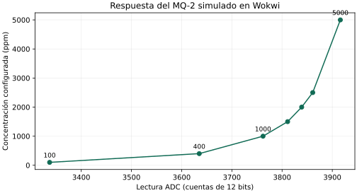

# Caracterización del MQ-2 de Wokwi

El ESP32 digitaliza AOUT con 12 bits. La escala original usaba todo el recorrido 0–4095 como si correspondiera linealmente a 0–10 000 ppm. A 400 ppm el ADC entregó 3628 cuentas y el algoritmo heredado informó 8859.6 ppm. El error de 8459.6 ppm encendió la baliza roja.

| ADC de referencia | ppm configuradas |
|---:|---:|
|3337|100|
|3635|400|
|3762|1000|
|3811|1500|
|3839|2000|
|3861|2500|
|3916|5000|

Para una lectura $a$ entre dos puntos consecutivos $(a_i,p_i)$ y $(a_{i+1},p_{i+1})$, el firmware calcula

$$p(a)=p_i+(a-a_i)\frac{p_{i+1}-p_i}{a_{i+1}-a_i}.$$

Entre 3337 y 3635 cuentas la pendiente es 1.007 ppm/cuenta. Entre 3861 y 3916 asciende a 45.45 ppm/cuenta. Una variación de una cuenta tiene efectos distintos según el tramo. Fuera del intervalo se omite la telemetría de gas. Por encima de 3916 se mantiene la advertencia roja y por debajo de 3337 se indica lectura fuera de rango con azul.

| Consigna visible (ppm) | ADC | Salida (ppm) | Error absoluto (ppm) | Error relativo | Baliza |
|---:|---:|---:|---:|---:|---|
|400|3628|393.0|7.0|1.75 %|[Verde](../../evidencias/pruebas/N2-Secadores/F6_Calibracion/400ppm-verde.jpg)|
|1828|3831|1857.1|29.1|1.59 %|[Amarilla](../../evidencias/pruebas/N2-Secadores/F6_Calibracion/1828ppm-amarilla.jpg)|
|2524|3861|2500.0|24.0|0.95 %|[Roja](../../evidencias/pruebas/N2-Secadores/F6_Calibracion/2524ppm-roja.jpg)|

Se usó $|p-r|$ y $100|p-r|/r$, donde $r$ es la consigna mostrada por el control de Wokwi. El mando logarítmico avanzó en incrementos de 0.02, por lo que las dos consignas altas difieren de las nominales del [ensayo anterior](../../evidencias/pruebas/N2-Secadores.md). La curva caracteriza el modelo simulado. Su aplicación a un sensor físico requeriría gases patrón, control ambiental y estimación de incertidumbre.
