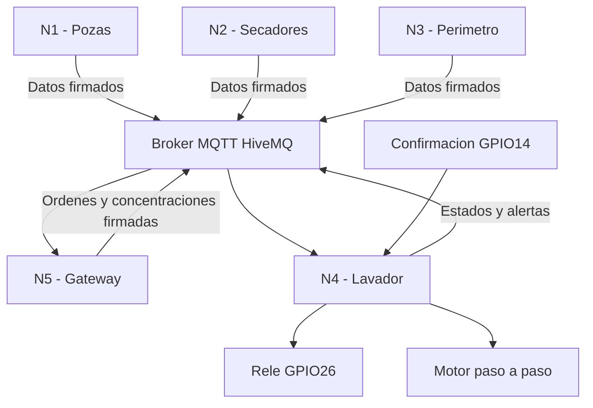

# N4-Lavador — Planta Costa Norte (G1)

## Información general

- **Curso:** 1ASI0572 — Desarrollo de Soluciones IoT.
- **Laboratorio:** 4 — Instalación heredada.
- **Grupo:** G1.
- **Responsable:** Fabricio Fabian Quispe Barzola.
- **Rol:** Integrante 4 — N4-Lavador.
- **Revisor asignado:** Integrante 3.

## Proyectos Wokwi

- [Instalación heredada de N4](https://wokwi.com/projects/481590024229204993).
- [Instalación corregida de N4](https://wokwi.com/projects/481668300518825985).
- [Instalación corregida de N5-Gateway](https://wokwi.com/projects/481701580182887425).
- [Copia de N5 utilizada para las pruebas de integración](https://wokwi.com/projects/481779426126558209).

## 1. Descripción del nodo

El nodo N4-Lavador controla el sistema de lavado de gases de la Planta Costa Norte mediante un ESP32 conectado a una red MQTT.

Su funcionamiento comprende la recepción de órdenes del gateway, la activación del relé, el control del motor paso a paso, la confirmación de funcionamiento y la generación de alertas.

La implementación incorpora mecanismos de autenticación HMAC-SHA256, validación temporal mediante NTP, protección contra órdenes repetidas y activación preventiva ante pérdida de comunicación.

El nodo utiliza el prefijo MQTT oficial del grupo y un contrato de comunicación compatible con N5-Gateway, permitiendo la ejecución de pruebas integradas de activación, apagado y confirmación local del funcionamiento.

## 2. Componentes y conexiones

| Componente | Conexión | Función |
|---|---|---|
| ESP32 DevKit | — | Procesamiento y comunicación |
| Módulo relé | GPIO26 | Activación del lavador |
| Interruptor deslizante | GPIO14 | Confirmación de funcionamiento |
| Driver A4988 STEP | GPIO18 | Control de pasos del motor |
| Driver A4988 DIR | GPIO19 | Control de dirección |
| Motor paso a paso | A4988 | Simulación del lavador |
| LED verde | Contacto NO del relé | Indicador visual |
| Resistencia 220 Ω | En serie con LED | Protección del indicador |

El relé utiliza HIGH como estado activo y LOW como estado inactivo, de acuerdo con las pruebas realizadas en Wokwi.

## 3. Bitácora de fallas

| ID | Tipo | Síntoma | Causa raíz | Corrección | Referencia |
|---|---|---|---|---|---|
| F13 | Visible | Funcionamiento incorrecto del relé | GPIO27 declarado en firmware y GPIO26 conectado en circuito | Corrección de GPIO y polaridad; incorporación de indicador LED | `21927c9` |
| F14 | Silenciosa | Ausencia de activación del modo seguro | Reinicio del temporizador mediante mqtt.connected() | Control de último contacto mediante recepción de mensajes válidos del gateway | `a69050e` |
| F15 | Seguridad | Aceptación de órdenes no autenticadas | Ausencia de validación de firma y vigencia | HMAC-SHA256, NTP, protección contra replay y restricciones de apagado | `5388fdd` |
| F16 | Cruzada | Comunicación incompatible entre N4 y N5 durante la integración | Diferencias de prefijos MQTT y desfases temporales entre las simulaciones | Unificación de tópicos, contrato HMAC compatible, resincronización periódica NTP y diagnóstico MQTT | [Evidencias F16](../evidencias/pruebas/N4-Lavador/F16_Integracion/README.md) |

## 4. Diagnóstico y correcciones

### F13 — Falla visible

El firmware heredado declaraba GPIO27 para el control del relé, mientras que el circuito se encontraba conectado al GPIO26.

Se corrigió la asignación del pin y la polaridad de activación. Adicionalmente, se incorporó un LED verde conectado al contacto normalmente abierto del relé mediante una resistencia de 220 Ω.

**Resultados obtenidos:**

- Relé desactivado: LED apagado y motor detenido.
- Relé activado: LED encendido y motor en funcionamiento.
- Correspondencia entre el estado lógico y la actuación física simulada.

**Paso del marco IoT:** paso 8, sensores y actuadores.

**Commit:** `21927c9`.

**Pull request:** [PR #1](https://github.com/educmz/laboratorio-4-planta-costa-norte-g1/pull/1).

**Evidencias:** [F13 — Corrección del relé](../evidencias/pruebas/N4-Lavador/F13_Rele/).

### F14 — Falla silenciosa

El firmware heredado actualizaba el tiempo de último contacto mientras permanecía conectado al broker MQTT.

Esta lógica impedía distinguir entre una conexión activa con el broker y la recepción efectiva de mensajes del gateway.

La corrección establece el seguimiento del último mensaje válido y activa el modo seguro cuando se superan los 60 segundos sin contacto autenticado.

**Resultados obtenidos:**

- Lavador OFF a los 56,044 segundos.
- Lavador ON mediante modo seguro a los 64,391 segundos.
- Activación preventiva con intensidad máxima.
- Generación de alerta de pérdida de contacto.
- Recuperación del contacto mediante mensajes autenticados.

El modo seguro también fue observado durante las pruebas de integración F16, cuando los mensajes del gateway fueron rechazados por desfase temporal.

**Regla relacionada:** R6.

**Commit:** `a69050e`.

**Pull request:** [PR #2](https://github.com/educmz/laboratorio-4-planta-costa-norte-g1/pull/2).

**Evidencias:** [F14 — Modo seguro](../evidencias/pruebas/N4-Lavador/F14_Modo_seguro/).

### F15 — Falla de seguridad

El firmware heredado procesaba órdenes MQTT sin comprobar su autenticidad.

Se implementaron los siguientes mecanismos:

- Autenticación HMAC-SHA256.
- Sincronización temporal mediante NTP.
- Validación de antigüedad de mensajes.
- Protección contra repetición de mensajes durante la ejecución.
- Rechazo de firmas incorrectas.
- Restricción de apagado ante concentración elevada.
- Restricción de apagado sin información válida de concentración baja.
- Separación de credenciales mediante secrets.h.

**Resultados obtenidos:**

- Rechazo de órdenes sin firma.
- Rechazo de firmas incorrectas.
- Rechazo de mensajes repetidos.
- Aceptación de órdenes autenticadas.
- Apagado permitido con concentración de 1500 ppm.
- Apagado rechazado con concentración de 2500 ppm.

Durante la integración F16 se comprobó adicionalmente la aceptación de órdenes y concentraciones autenticadas generadas por el firmware de N5-Gateway.

**Reglas relacionadas:** R7, R9 y R10.

**Commit:** `5388fdd`.

**Pull request:** [PR #3](https://github.com/educmz/laboratorio-4-planta-costa-norte-g1/pull/3).

**Evidencias:** [F15 — Seguridad MQTT](../evidencias/pruebas/N4-Lavador/F15_Seguridad/).

### F16 — Falla cruzada: integración N4-Lavador y N5-Gateway

#### Síntoma

Durante la integración de ambos nodos se identificaron dificultades en la recepción y validación de los mensajes enviados por N5-Gateway.

N4 podía establecer una conexión con el broker MQTT, pero presentaba interrupciones en la recepción de concentraciones y órdenes válidas.

#### Causas identificadas

- Diferencia entre el prefijo MQTT aislado de N4 y el prefijo oficial utilizado por N5.
- Desfases temporales entre los relojes de ambos ESP32 durante las simulaciones Wokwi.
- Diferencias en la tolerancia de adelanto temporal de los mensajes.
- Desconexiones intermitentes durante la ejecución simultánea de las simulaciones.

Durante el diagnóstico se observaron mensajes adelantados hasta 266 segundos y mensajes con una antigüedad de 82 segundos. Estos mensajes fueron rechazados por las validaciones de seguridad.

#### Correcciones implementadas

- Unificación de los tópicos MQTT mediante el prefijo oficial `upc/ga/`.
- Identificador MQTT específico para N4-Lavador.
- Compatibilidad con el formato de órdenes autenticadas de N5-Gateway.
- Resincronización periódica NTP cada 15 segundos.
- Tolerancia de adelanto temporal de 15 segundos para el entorno de simulación.
- Conservación del límite máximo de antigüedad de 60 segundos.
- Configuración del Keep Alive MQTT en 60 segundos.
- Verificación del envío de solicitudes de suscripción MQTT.
- Incorporación de registros de diagnóstico para mensajes recibidos.

Las correcciones mantienen los mecanismos de seguridad implementados en F15 y el comportamiento preventivo de F14.

#### Entorno de pruebas

La integración se realizó utilizando:

- N4-Lavador ejecutado en Wokwi.
- N5-Gateway ejecutado en una copia de pruebas de Wokwi.
- Simulador HTML de los sensores N1-Pozas, N2-Secadores y N3-Perímetro.
- Broker MQTT HiveMQ.
- Clave HMAC compartida para la simulación.
- Publicación de sensores cada 2 segundos.
- Dirección del viento de 135°.
- Confirmación automática del simulador HTML desactivada.

La confirmación fue generada por el mecanismo de realimentación del nodo N4 y no por el lavador simulado del HTML.

#### Resultados experimentales

| Prueba | Resultado observado |
|---|---|
| Conexión MQTT de N4 y N5 | Conexión establecida |
| Recepción de concentración normal | 400 ppm aceptados |
| Recepción de concentración elevada | 2500 ppm aceptados |
| Autenticación HMAC | Mensajes válidos aceptados |
| Validación temporal | Mensajes fuera del margen rechazados |
| Activación integrada | Lavador ON mediante orden del gateway |
| Retorno a condiciones normales | Estado OFF observado y recibido por N5 |
| Confirmación local | 2460 ms |
| Publicación MQTT de confirmación | Estado CONFIRMADO publicado |
| Activación preventiva | Modo seguro observado ante ausencia de mensajes válidos |

#### Medición de confirmación

Durante la prueba de integración se registró la activación del lavador mediante una orden autenticada del gateway y la posterior confirmación del mecanismo de realimentación.

```text
[RX MQTT] upc/ga/gateway/conc
[NTP] ESP32: 1795720891 | Mensaje: 1795720885 | Diferencia: 6 s
[CONCENTRACION] 2500.0 ppm
[RX MQTT] upc/ga/lavador/cmd
[NTP] ESP32: 1795720891 | Mensaje: 1795720885 | Diferencia: 6 s
[LAVADOR] ON: orden gateway
```

Posteriormente, N4 publicó:

```text
[MQTT] upc/ga/lavador/estado -> {"lavador":"CONFIRMADO"}
[CONFIRMACION] Tiempo: 2460 ms
```

| Indicador | Valor |
|---|---:|
| Concentración recibida | 2500 ppm |
| Tiempo de confirmación local | 2460 ms |
| Tiempo de confirmación local en segundos | 2,460 s |
| Umbral de referencia R5 | 10000 ms |
| Margen respecto al umbral | 7540 ms |
| Intensidad del lavador | 1 |
| Modo seguro durante la confirmación | Desactivado |

El tiempo registrado corresponde al intervalo entre la activación local del lavador y la detección de su confirmación. Este resultado se encuentra dentro del umbral temporal de referencia establecido por R5.

La medición no representa la latencia integral desde la detección inicial de los sensores hasta la recepción de la confirmación en N5.

#### Evidencias

La documentación experimental de F16 comprende 11 capturas y un registro serial de N4.

- [Evidencias de integración F16](../evidencias/pruebas/N4-Lavador/F16_Integracion/README.md).
- [Registro serial completo de N4](../evidencias/pruebas/N4-Lavador/F16_Integracion/F16-Registro-serial-N4.md).
- [Contrato de integración con N5](docs/INTEGRACION-N5.md).
- [Mediciones del lazo cerrado](docs/MEDICION-LAZO-CERRADO.md).

**Reglas relacionadas:** R4, R5, R6, R7, R9 y R10.

**Corrección complementaria de N5:** [PR #14 — Órdenes y concentraciones autenticadas](https://github.com/educmz/laboratorio-4-planta-costa-norte-g1/pull/14).

## 5. Comunicación MQTT

### Configuración

| Parámetro | Configuración |
|---|---|
| Broker | broker.hivemq.com |
| Puerto MQTT | 1883 |
| Puerto WebSocket | 8884 |
| Prefijo oficial | upc/ga/ |
| Keep Alive | 60 segundos |
| Periodicidad de publicación | 2 segundos de simulación |
| Resincronización NTP | 15 segundos de simulación |
| Antigüedad máxima de mensajes | 60 segundos |
| Tolerancia de adelanto | 15 segundos |

El prefijo aislado `upc/ga-n4-test-481668300518825985/` fue utilizado durante las pruebas individuales de F13, F14 y F15. Para las pruebas de integración F16 se adoptó el prefijo oficial del grupo.

### Tópicos MQTT

| Topic | Dirección | Función |
|---|---|---|
| upc/ga/lavador/cmd | N5 → N4 | Recepción de órdenes autenticadas |
| upc/ga/gateway/conc | N5 → N4 | Recepción de concentración autenticada |
| upc/ga/lavador/estado | N4 → N5 | Publicación de estados y confirmaciones |
| upc/ga/lavador/alerta | N4 → N5 | Publicación de alertas |

### Formato de mensajes autenticados

Activación del lavador:

```text
gateway|timestamp|cmd:ON|firma
```

Desactivación del lavador:

```text
gateway|timestamp|cmd:OFF|firma
```

Regulación de intensidad:

```text
gateway|timestamp|cmd:INT:5|firma
```

Publicación de concentración:

```text
gateway|timestamp|conc:2500.0|firma
```

La firma corresponde a los primeros 16 caracteres hexadecimales del resultado HMAC-SHA256 aplicado a los tres primeros campos del mensaje.

### Estado de confirmación

```json
{
  "nodo": "lavador",
  "lavador": "CONFIRMADO",
  "intensidad": 1,
  "modoSeguro": false,
  "confirmado": true
}
```

Las órdenes y concentraciones recibidas por N4 utilizan autenticación HMAC. Los mensajes de estado y alerta de la interfaz experimental utilizan JSON sin firma.

## 6. Arquitectura de integración



N5-Gateway centraliza las decisiones de activación y apagado del lavador.

N4 valida las órdenes recibidas, controla los actuadores y publica la información de funcionamiento.

El mecanismo de confirmación permite diferenciar entre una orden de activación y la respuesta efectiva del actuador.

## 7. Control de versiones

| Implementación | Rama | Commit | PR |
|---|---|---|---|
| Instalación heredada | main | `bbc3ce1` | — |
| Corrección F13 | bugfix/lavador-pin-rele | `21927c9` | [#1](https://github.com/educmz/laboratorio-4-planta-costa-norte-g1/pull/1) |
| Corrección F14 | bugfix/lavador-modo-seguro | `a69050e` | [#2](https://github.com/educmz/laboratorio-4-planta-costa-norte-g1/pull/2) |
| Corrección F15 | bugfix/lavador-autenticacion-hmac | `5388fdd` | [#3](https://github.com/educmz/laboratorio-4-planta-costa-norte-g1/pull/3) |
| Documentación | docs/lavador-n4 | Historial del repositorio | #4 y #5 |
| Integración F16 | bugfix/lavador-integracion-gateway (rama propuesta) | Versión experimental en Wokwi | [Evidencias F16](../evidencias/pruebas/N4-Lavador/F16_Integracion/README.md) |

Las correcciones F13, F14 y F15 fueron incorporadas a la rama principal mediante pull requests.

Los resultados de F16 corresponden a la versión experimental ejecutada en Wokwi el 26 de noviembre de 2026.

## 8. Configuración y ejecución

### Configuración individual

1. Abrir el proyecto corregido de N4-Lavador en Wokwi.
2. Configurar secrets.h utilizando secrets.example.h como plantilla en la versión del repositorio.
3. Introducir localmente la clave de autenticación acordada por el grupo.
4. Iniciar la simulación.
5. Verificar la conexión WiFi, MQTT y sincronización NTP.
6. Utilizar mensajes autenticados para controlar el lavador.

El archivo secrets.h se mantiene fuera del control de versiones.

### Ejecución integrada con N5

1. Abrir el proyecto corregido de N4-Lavador.
2. Abrir el proyecto de N5-Gateway.
3. Ejecutar el simulador HTML de sensores ubicado en `N5-Gateway/tests/`.
4. Configurar el prefijo `ga` y la clave HMAC compartida.
5. Activar la publicación de los tres sensores cada 2 segundos.
6. Desactivar la confirmación automática del lavador simulado.
7. Iniciar ambas simulaciones Wokwi.
8. Verificar la recepción de concentraciones normales de 400 ppm.
9. Ejecutar el escenario de concentración elevada de 2500 ppm y viento de 135°.
10. Verificar la activación del lavador mediante una orden autenticada de N5.
11. Accionar el interruptor de confirmación del GPIO14.
12. Observar la publicación MQTT del estado CONFIRMADO.
13. Restablecer el escenario normal de 400 ppm y observar el apagado.

Para reducir los problemas de sincronización, las simulaciones deben mantenerse ejecutándose en ventanas independientes y visibles.

## 9. Documentación técnica

- [Registro de pruebas](docs/PRUEBAS.md).
- [Contrato de integración](docs/INTEGRACION-N5.md).
- [Mediciones de respuesta](docs/MEDICION-LAZO-CERRADO.md).
- [Sustentación individual](docs/SUSTENTACION.md).
- [Índice general de evidencias](../evidencias/pruebas/N4-Lavador/INDICE.md).
- [Evidencias de integración F16](../evidencias/pruebas/N4-Lavador/F16_Integracion/README.md).
- [Registro serial de integración F16](../evidencias/pruebas/N4-Lavador/F16_Integracion/F16-Registro-serial-N4.md).

## 10. Resumen de evidencias

| Categoría | Cantidad |
|---|---:|
| F13 — Relé | 5 |
| F14 — Modo seguro | 3 |
| F15 — Seguridad | 9 |
| Confirmación y alertas | 6 |
| MQTT y NTP | 6 |
| Diagnóstico | 1 |
| F16 — Integración | 11 |
| **Total** | **41** |

Las capturas y registros seriales documentan las diferentes etapas de diagnóstico, implementación, corrección y validación experimental del nodo.

## 11. Resultados generales

| Falla | Resultado experimental |
|---|---|
| F13 — Visible | Control adecuado del relé mediante GPIO26 y verificación visual de la actuación |
| F14 — Silenciosa | Activación preventiva del modo seguro después de 60 segundos sin contacto válido |
| F15 — Seguridad | Validación HMAC, rechazo de órdenes inválidas y protección del apagado |
| F16 — Cruzada | Comunicación autenticada con N5, activación integrada, retorno al estado OFF y confirmación local en 2460 ms |

La implementación corregida demuestra:

- Control adecuado del relé y motor paso a paso.
- Activación preventiva ante pérdida de contacto.
- Validación de órdenes mediante HMAC-SHA256.
- Rechazo de órdenes no autorizadas.
- Restricción de apagado ante concentración elevada.
- Detección de confirmación, pérdida de confirmación y generación de alertas.
- Compatibilidad de comunicación entre N4 y N5.
- Recepción de concentraciones autenticadas.
- Activación del lavador mediante órdenes del gateway.
- Confirmación local dentro del umbral temporal de referencia de 10 segundos.

## 12. Alcance experimental

Los resultados de F13, F14 y F15 corresponden a pruebas individuales realizadas en Wokwi.

Los resultados de F16 corresponden a pruebas conjuntas de N4-Lavador y N5-Gateway, utilizando un simulador HTML para representar los nodos sensores N1, N2 y N3.

El registro experimental acredita la activación autenticada de N4 y la publicación de su confirmación local en 2460 ms. La recepción de dicha confirmación en N5, la latencia integral de los cinco nodos y las pruebas integradas de respaldo y seguridad constituyen mediciones distintas de los resultados locales aquí presentados.

Durante la integración también se observaron variaciones temporales y eventos de pérdida y recuperación de confirmación propios de los escenarios ejecutados.

## 13. Conclusiones

El diagnóstico de N4-Lavador permitió identificar cuatro tipos de fallas: visible, silenciosa, de seguridad y cruzada.

La corrección F13 permitió establecer una correspondencia adecuada entre el firmware y las conexiones físicas del relé.

La corrección F14 mejoró la disponibilidad del lavador mediante un mecanismo de activación preventiva ante pérdida de contacto con el gateway.

La corrección F15 incorporó mecanismos de autenticación, validación temporal y protección frente a órdenes MQTT no autorizadas.

La implementación F16 permitió establecer comunicación autenticada entre N4-Lavador y N5-Gateway, unificar los tópicos MQTT y verificar experimentalmente la activación del lavador mediante órdenes del gateway.

Como resultado de las pruebas integradas, N4 registró una confirmación local de funcionamiento en 2460 ms, valor inferior al umbral temporal de referencia de 10 segundos.

El desarrollo se encuentra respaldado mediante código fuente, documentación técnica, proyectos Wokwi, historial de versiones, 41 capturas de evidencia y registros seriales experimentales.